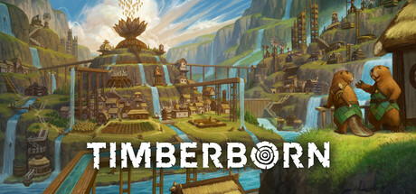

**Timberborn by Mechanistry (Early Access 2021) is a city builder starring beaver colonists.**

---

## 📖 About

Timberborn by Mechanistry (Early Access 2021) is a city builder starring beaver colonists. Your dams and waterways control the entire map's survival during droughts. Its unique water simulation means every building placement decision has hydrological consequences.

## ⚠️ Problems Without Trainer

| Problem | Status |
|---------|--------|
| Drought cycles wipe food and water reserves killing entire populations | ✅ Solved |
| Water pumping infrastructure requires complex levee and floodgate networks | ✅ Solved |
| Beaver population growth outpaces food production in mid-game exponentially | ✅ Solved |
| Badwater contamination spreads silently before filtration systems are built | ✅ Solved |
| District power and gear manufacturing chains require extensive planning ahead | ✅ Solved |

## ✅ Solution

The **Timberborn Trainer** solves all these issues, giving you complete control so you can focus on enjoying the game.

## 🎯 Features

- Unlimited Resources / Currency
- God Mode / Invincibility
- Instant Skill & Ability Cooldown
- One-Hit Kill
- Freeze Timers
- Unlock All Items & Achievements
- Custom Speed Multiplier
- Infinite Stamina / Energy

## 🚀 Quick Start

1. **Disable Windows Defender** temporarily (trainer may trigger false positive)
2. Get the trainer from the button above
3. Launch Timberborn
4. Run the trainer as Administrator
5. Use the hotkeys to activate cheats in-game

## 💎 Free vs Pro

| Feature | Free | Pro |
|---------|------|-----|
| God Mode | ✅ | ✅ |
| Unlimited Resources | ✅ | ✅ |
| Advanced Cheats | ❌ | ✅ |
| Auto-Updates | ❌ | ✅ |
| Priority Support | ❌ | ✅ |

## 💻 Requirements

- Windows 10 / 11 (64-bit)
- Timberborn (any version)
- .NET Framework 4.8+
- DirectX 11+

## 🍎 macOS

## ⚖️ Legal

Educational and single-player use only.

---

